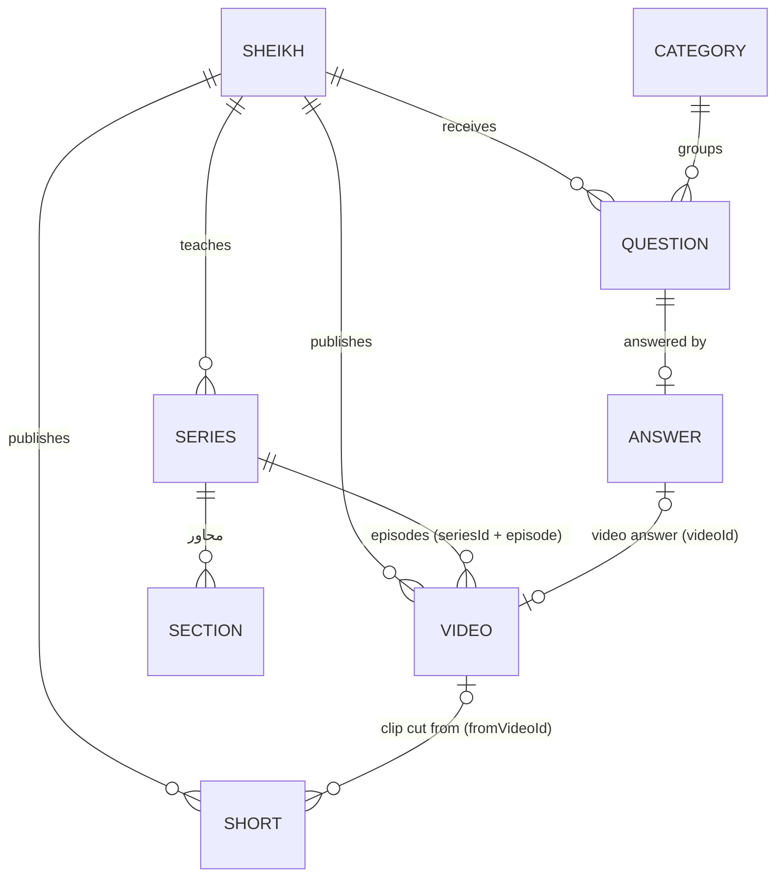

# 0001. Content model for several sheikhs, series, shorts and Q&A

**Date**: 2026-11-05
**Status**: Accepted (front end built on it; backend to implement)

## Summary

Everything on the site belongs to a sheikh: lesson series, videos, short clips and answered questions. A sheikh can have any number of series (دلائل النبوّة is one of them, not a special case). Shorts are TikTok clips we download and host ourselves. Questions are anonymous: we store the question text, never who asked. This page is the contract between the public site, the admin panel and the backend.

## Context

The first version had one sheikh and one hard-wired series. The site now needs several sheikhs, many series, a TikTok-fed shorts section and a real question and answer flow (text and voice answers). The public site (this repo), the admin panel (front end, built in a separate session) and the backend (another developer) must agree on the same shapes.

The front end currently reads sample data from `src/data/content.ts`. Every page goes through the query helpers at the bottom of that file, so moving to the API means replacing those helpers, not the pages.

## Entities

Types live in `src/lib/types.ts`. Text the site shows in several languages is a `LocalizedText`: `{ ar, fr, kab }`. Dates are ISO `YYYY-MM-DD`. Durations are `"m:ss"` / `"h:mm:ss"` strings in the front end; the API may send seconds (`durationSec`) and the client formats them.

### Sheikh

| Field | Type | Notes |
| --- | --- | --- |
| `id` | string | stable id |
| `slug` | string | URL: `/ar/sheikhs/<slug>` |
| `name` | LocalizedText | with the title, e.g. "الشيخ …" |
| `bio` | LocalizedText? | one or two lines |
| `photo` | string? | portrait URL (admin brief calls it `avatarUrl`) |
| `monogram` | string | one letter for the round avatar when there is no photo |
| `socials` | `{ telegram?, tiktok?, youtube? }` | full URLs |
| `takesQuestions` | boolean? | shown in the "ask" form |

### Series (سلسلة)

A numbered lesson series. Any number per sheikh. Page: `/ar/series/<slug>`.

| Field | Type | Notes |
| --- | --- | --- |
| `id`, `slug`, `sheikhId` | string | |
| `title`, `description`, `tagline?` | string | written in the series language |
| `lang` | `ar` \| `fr` \| `kab` | language of the lessons |
| `glyph` | string | big outlined letter on tiles, e.g. "د", "40" |
| `plannedCount` | number | episodes planned (published ones may be fewer) |
| `sections` | `{ id, title }[]` | the محاور; section ids are unique across all series |
| `status` | `ongoing` \| `complete` | |
| `featured` | boolean? | the one series shown in the home spotlight |

Episode order is stored on the video (`seriesId` + `episode` + `sectionId`). The admin panel's "reorder episodes" writes new `episode` numbers. (The admin brief describes the same thing as an ordered `videoIds` list; either representation is fine on the wire as long as the API returns episodes in order.)

### Video

| Field | Type | Notes |
| --- | --- | --- |
| `id`, `sheikhId`, `title` | string | |
| `lang` | Locale | language spoken |
| `kind` | `series` \| `kabyle` \| `qa` \| `mixed` | drives the cover colour |
| `duration`, `publishedAt` | string | |
| `seriesId?`, `episode?`, `sectionId?` | | set for episodes |
| `summary?`, `description?`, `chapters?`, `captions?`, `topics?`, `thumbnail?` | | `topics` feed search |

The API should also carry `status: draft | published` and the media source (`{ kind: "youtube", youtubeId }` or `{ kind: "upload", url }`); the public site only receives published videos.

### Short

A vertical clip, normally imported from the sheikh's TikTok and hosted by us.

| Field | Type | Notes |
| --- | --- | --- |
| `id`, `sheikhId`, `title` | string | `id` is `tt-<tiktok id>` for imports |
| `lang`, `duration`, `publishedAt` | | |
| `source` | `{ platform: "tiktok", url, externalId }` | link back to the original |
| `mediaUrl?` | string | our copy; absent = not downloaded yet (the feed links to TikTok) |
| `posterUrl?` | string | cover frame |
| `topics?` | string[] | hashtags |
| `tone?` | ContentKind | colour of the content it was cut from |
| `fromVideoId?` | string | the full lesson ("watch the full lesson" button) |
| `transcript?` | string | planned, not MVP |
| `status` | `published` \| `pending` \| `hidden` | only `published` is shown |

### Question, Answer, Category

| Field | Type | Notes |
| --- | --- | --- |
| `id`, `sheikhId`, `body` | string | `body` is the only thing the visitor writes |
| `lang` | Locale | language of the question |
| `categoryId` | string | see `questionCategories` |
| `askedAt` | date | |
| `status` | `pending` \| `answered` \| `rejected` | |
| `isPublic` | boolean | visitor agreed to publish it once answered |
| `answer?` | Answer | |

Answer: `{ kind: "text" | "voice" | "video", text?, audioUrl?, audioDuration?, videoId?, answeredAt }`. For voice and video answers `text` is an optional written summary.

**Privacy rule:** a question record never holds a name, e-mail, phone, IP address, cookie id or user agent. The visitor follows it with a random **tracking code** (`K7Q-4M2`, no look-alike characters) that is shown once and kept in their browser. The backend stores only a hash of the code.

Category: `{ id, title: LocalizedText }`.

### Member (admin side)

`{ id, name, email?, telegram?, role: "owner" | "admin" | "editor", sheikhIds[], status: "active" | "invited" | "requested" }`. Owned by the admin panel spec (`docs/specs/admin-api.md`).

## Read API the public site needs

All public endpoints return published content only.

| Endpoint | Returns |
| --- | --- |
| `GET /sheikhs` · `GET /sheikhs/:slug` | Sheikh |
| `GET /series?sheikh=` · `GET /series/:slug` | Series (+ its episodes in order) |
| `GET /videos?sheikh=&series=&kind=&lang=&limit=&before=` | Video[] newest first (archive, latest) |
| `GET /videos/:id` | Video |
| `GET /shorts?sheikh=&limit=&before=` · `GET /shorts/:id` | Short |
| `GET /questions?sheikh=&category=&kind=&q=` · `GET /questions/:id` | answered, public Question |
| `GET /categories` | QuestionCategory[] |
| `GET /search?q=&scope=&sheikh=` | same grouped shape as `search()` in `src/data/search.ts` |
| `POST /questions` · `GET /questions/track/:code` | see 0006 |

## Decision

One model, keyed by `sheikhId` everywhere; series are data, not code; shorts and questions are first-class entities. Pages depend only on the helpers in `src/data/content.ts` and `src/data/search.ts`, so the switch to the API is local to those two files.
